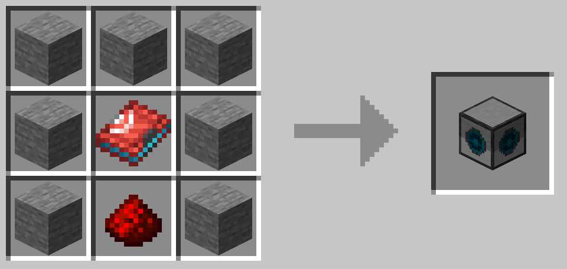

# CC-Cobblemon
 
CC-Cobblemon adds compatibility with [CC: Tweaked](https://tweaked.cc/) and [Cobblemon](https://cobblemon.com).

## Features

### Pokémon Scanner

The Pokémon Scanner is a block that can be used to scan the environment for Pokémon.
It is crafted with 7 Stone, 1 Redstone and a Pokédex of any Color.

When connected as a Peripheral it gives following functions:

#### Functions `getScannerRange`, `setScannerRange(int)`

Gets or Sets the Scanner Range with a maximum of 10 Blocks

#### Function `getPokemon`

Returns a list of all Pokémon nearby. With values like species, level, gender, aspecs, stats and riding_stats to name a few.

### Healing Machine

The Healing Machine also gets a peripheral. It allows you to check how much charge it has and who's and what Pokémon are healed.

#### Function `getCharge`

Gets the current Charge of a Healing Machine

#### Function `getMaxCharge`

Gets the max charge possible on the Healing Machine

#### Event "healing_machine_used"

When connected this event fires when the Healing Machine is used, giving the current Trainer that uses it and their Pokémon.

### Pasture

The Pasture allows you to get the Pokémon currently outside the pasture.

#### Function `getOwner`

Returns the name of the Pasture Owner

#### Function `getPokemon`

Returns the Pokémon outside the Pasture

### Turtle Upgrades

The Turtle can use the Pokémon Scanner Block as an Upgrade with the same features as the Computer Peripheral with the difference that it is mobile!

### Pocket Upgrade

The Pocket Computer also can utilize the Pokémon Scanner as an Upgrade. The same can be done with every Pokédex too!
Additionally, there are more functions available! **Those functions only work when used by a player, else they return nil!**

#### Function `getTeam`

Returns you a list of your Pokémon team.

#### Function `getPokedexPokemonEntry(String)`

Returns you the entry of your Pokédex with the id of that Pokémon (E.g.: `"cobblemon:pikachu"`)

#### Function `getDiscoveredSpecies`

Returns you a list of your discovered Pokémon.

## Future Features

 - **More Events**
   - Battle Events (Attack, Weather Effects, Item Used, etc.) (Hard to implement)
   - Pasture Events (Pokémon Fighting, Pokémon Defeated, [Cobbleworkers](https://modrinth.com/mod/cobbleworkers) Events)
 - **More Functions/Function Improvements**
   - Pokédex numberation
   - More Information like attacks
 - **Datapack Support**
   - Allow, disallow functions or specific functionalities
   - Premade scripts
 - **Fabric version**
 - **Anything else, you may ask me for Suggestions on [GitHub](https://github.com/Naturesocks/cc-cobblemon)**
 - **I will not guarantee that I will follow up with the project. It is a hobby at first.**